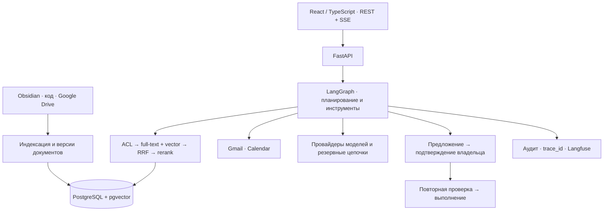

# Persona

Персональный AI-помощник одного владельца: поиск по заметкам, документам и коду, подготовка встреч и исследование вопросов с опорой на источники.

Личный контекст разбросан по Obsidian, Google Drive, исходникам, почте и календарю. Persona собирает работу с ним в одном интерфейсе: помогает найти материал, понять его и перейти к действию. Предложенные чат-агентом изменения проходят подтверждение владельца.

## Сценарии

- **Найти ответ в своих материалах.** Гибридный поиск по Obsidian, документам Google Drive и коду; ответ со ссылками на найденные фрагменты. Если материалов нет, RAG-сценарий возвращает сообщение об отсутствии источников.
- **Разобраться в проекте.** Отдельный агент читает исходники и заметки через Read/Grep/Glob с проверкой допустимых путей, без инструментов записи и shell.
- **Подготовить и разобрать встречу.** Бриф, запись или загрузка аудио, расшифровка, протокол с решениями и задачами. Пункты протокола ссылаются на сегменты расшифровки; пропущенный ответственный или срок помечается для уточнения.
- **Исследовать сложный вопрос.** Подвопросы, параллельный сбор материалов из документов, почты, календаря и веба, затем отчёт со ссылками. Веб и личные файлы изучаются разными агентскими сессиями.
- **Подтвердить действие.** Карточка в чате, пауза выполнения и повторная проверка доступности инструмента перед изменением. Уведомления и решения доступны также через подключённого Telegram-бота.
- **Настроить регулярную работу.** Автоматизации по расписанию и событиям, сводки, напоминания и личный круг контактов.

Подробности сценариев и ограничения — [docs/scenarios.md](docs/scenarios.md).

## Архитектура

Эмбеддинги считаются локально через Ollama. Генерация ответов, распознавание аудио и реранк используют внешних провайдеров: размещение приложения на своём сервере не означает полностью локальную обработку.

Подробнее: [поиск, агентские ограничения и обработка сбоев](docs/architecture.md).

## Стек

| Слой | Технологии |
| --- | --- |
| Backend | Python 3.12, FastAPI, Pydantic, asyncpg, httpx, SSE |
| Агенты | LangGraph, PostgreSQL checkpointer, Claude Agent SDK, MCP |
| Поиск | PostgreSQL 16, pgvector/HNSW, full-text RU/EN, RRF, Cohere rerank |
| Модели | Claude Code, Gemini, Groq, ElevenLabs; локальные bge-m3 через Ollama |
| Frontend | React 19, TypeScript, Vite, Tailwind CSS, TanStack Query, TipTap, React Flow |
| Инфраструктура | Docker Compose, nginx, CouchDB для синхронизации Obsidian, Langfuse |
| Проверки в проекте | pytest, Vitest, Playwright, Storybook |

## Статус

Развиваю Persona как опенсорс. **Код пока закрыт; готов показать приватно.** Этот репозиторий — публичное описание продукта и архитектуры, без исходников приложения.

Описанные возможности подтверждены чтением реализации. Полный прогон сценариев в работающем окружении и воспроизводимый запуск на чистом клоне в рамках подготовки этой витрины не выполнялись. Проверка ссылок в ответе не гарантирует достоверность каждого утверждения модели.

## Roadmap к открытому выпуску

- [ ] Отделить оставшийся корпоративный режим от персонального продукта.
- [ ] Проверить происхождение и лицензии материалов перед открытием исходников.
- [ ] Проверить запуск на чистом клоне и подготовить инструкцию запуска.
- [ ] Прогнать ключевые сценарии: поиск, подтверждения и отказы внешних сервисов.
- [ ] Добавить актуальные скриншоты на данных без личной информации.

## Автор и связь

[Damir Kucher](https://github.com/Kkkucher), Минск. Python / FastAPI, LLM / RAG / MCP.

[damir.kucher.work@gmail.com](mailto:damir.kucher.work@gmail.com)

Документация этой витрины распространяется под [MIT](LICENSE). Лицензия витрины не распространяется на закрытый код приложения.
